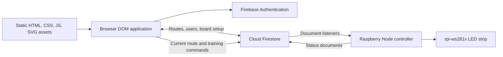

# Architecture

## System Overview

NapakBoard has a static browser application and an optional Raspberry Pi LED controller. There is no checked-in application HTTP server, REST API, middleware, scheduled cloud job, or Cloud Function. Firebase Authentication and Cloud Firestore are accessed directly through SDKs.



## Frontend

```text
index.html                    Static browser entry
css/, fonts/, images/         Presentation and hold/icon assets
hold_setup*.json              Local characteristics/sample hold layout
js/main.js                    Route registry and auth-driven startup
js/shared/                    Proxies, navigation, DOM/date/animation helpers
js/templates/                 Ten page views and shared off-canvas menu
js/components/                DOM controls, board/setup, route/tick/list managers
js/raspberry/index.js          Optional hardware process entry
js/raspberry/js/               Admin adapter, LED renderer, animation modules
js/raspberry/.env              Hardware configuration
js/raspberry/animation-tester.html  Standalone browser simulator
docs/                         This documentation set
```

- `index.html` imports `js/main.js`; Firebase browser modules are pinned to CDN version `9.10.0`.
- Ten view constructors are registered in `globals.routes`. Each builds native DOM elements and exposes `render()`.
- `route(name)` replaces `.page-content`, updates `globals.route`, and normally writes `#/name`. It does not listen for `hashchange` or `popstate` and does not perform permission checks.
- Initial navigation is decided by `main.js`: signed-in users see the recognized hash route or `board`; the exact query string `?setup` overrides this with `setup`. Unauthenticated startup goes to `login`, even if the hash names `signup` or `resetPassword`.
- `login` intentionally does not overwrite the hash. Signing in can therefore resume the previous hash route.
- The shared shell is the off-canvas menu, page container, status ticker, and per-page footer. Board interaction uses a scroll-snap board/comments layout; training uses a board plus order/settings panel. CSS is imported through `css/main.css`.
- Some `ds-*` controls are registered custom elements; others construct DOM controls. This is not React, a virtual DOM, or a client build framework.

## State and Caching

`globals` and `user` are JavaScript Proxies. Assigning observed top-level values triggers callbacks in `storeObservers`; mutations inside nested objects generally require a subsequent top-level assignment. `storeObserver.add()` replaces observers sharing an ID. The router calls `storeObserver.clear()` without the required argument, so route-change cleanup is not generally effective; individual views sometimes use `MutationObserver` cleanup instead.

Persisted browser state is limited to `localStorage.board` and the `napak_auth_hint` login hint. Firebase manages its own authentication state. Route caches and training queues are memory-only.

`RouteListManager` shares one routes listener for the current board/user and one user-document listener for TODOs. Closing its modal removes UI observers, not the shared listeners. Board changes stop the old routes listener; authentication changes clear account-specific caches. TODO mutations use Firestore array transforms. Training pages, history, profile, board setup, and route loading have their own reads/listeners; the modal cache does not eliminate those reads.

## Data Flow and Backend

Normal lighting writes a snapshot of selected hold types to `current/currentRoute_<boardId>`. The Raspberry listens to that document and renders the snapshot. Merely switching the browser lighting toggle off does not send an explicit off command.

Training commands are merged into `trainingSessions/<boardId>`. The Pi runs `startTrainingRun()`, normalizes hold groups, schedules timers, and reports progress through `boardStatus/boardStatus_<boardId>`. The phone waits for a matching `running` acknowledgment before starting its own progress clock, but later progress is mostly locally estimated rather than driven by every Pi status update.

```mermaid
sequenceDiagram
    participant Phone
    participant Firestore
    participant Pi
    Phone->>Firestore: trainingSessions/<board>: countdown + route snapshots
    Firestore->>Pi: training session snapshot
    Pi->>Pi: Prepare routes; light START companions; run 5s bar
    Pi->>Firestore: boardStatus/boardStatus_<board>: running + sessionId
    Firestore->>Phone: Matching running acknowledgment
    Phone->>Phone: Estimate steps and rests locally
    Pi->>Pi: Advance groups, rest, and clear on completion
    Phone->>Firestore: Pause, resume, stop, or complete
```

The Pi owns physical LED timing: START sets are prepared without an extra timed step; the last four complete sets remain visible; END companions light with the top holds. The three-frame zoom takes 180ms. A top-containing set lasts at least `zoomDurationMs + 3000`, or a longer configured delay. Rest previews the next route's START set. Completion and Stop clear lights and do not restore the old route. A new normal-route command interrupts training.

`systemboard.tick()` runs every 80ms. Training suppresses idle animations. Outside training, idle screensavers start after the configured idle period, run for the configured duration, clear, then wait through a break. There is no independent periodic status heartbeat; status timestamps are updated on startup and state changes.

## Coordinates and Dependencies

Stored hold IDs use a letter column and a top-down, one-based row. Displayed row labels are bottom-up: displayed row = board height - stored row + 1. Training labels convert presentation only; persisted IDs must not be inverted. The Pi uses a serpentine mapping influenced by width parity and `boardOffset`.

Browser dependencies: Firebase CDN modules, native DOM/custom elements, SVG hold/icon assets, Canvas 2D, local fonts, IntersectionObserver, and MutationObserver. Pi dependencies: `firebase-admin`, `rpi-ws281x`, and Node's `fs`. The Raspberry lockfile has an empty `packages` map, so no usable dependency versions are pinned. The separate animation tester reuses nine animation modules without Firebase or physical hardware.

## Source Map

- Browser routing/state: [main.js](../js/main.js), [route.js](../js/shared/route.js), [globals.js](../js/shared/globals.js), [user.js](../js/shared/user.js).
- Normal route workflows: [system_board.js](../js/components/system_board/system_board.js), [route-list.js](../js/components/system_board/route-list.js), [route-editor.js](../js/components/system_board/route-editor.js), [route-ticker.js](../js/components/system_board/route-ticker.js).
- Training: [session view](../js/templates/page_training-session.js), [sequence editor](../js/templates/page_training-route.js), [Pi controller](../js/raspberry/index.js).
- Configuration and hardware: [systemboard.js](../js/raspberry/js/systemboard.js), [firestore.js](../js/raspberry/js/firestore.js).
- Utilities: [helpers.js](../js/shared/helpers.js) supplies DOM/SVG creation, observers, and ascent scoring; [date.js](../js/shared/date.js) formats local dates; [animate.js](../js/shared/animate.js) binds CSS animation events; [route-utils.js](../js/components/system_board/route-utils.js) calculates votes and ascent summaries.

# Known Technical Debt

1. **Authorization is not established by this repository.** Owner checks hide setup/archive UI, but there are no deployed rules or server-side ownership checks to inspect. The README sample permits every authenticated user to read/write everything.
2. **Credential deployment is fragile.** Admin service-account fields are embedded in a JS file; its private-key value is incomplete. Do not publish a deployment containing a real private key in the static web tree.
3. **Build/runtime reproducibility is missing.** No `package.json`, CI, migration tooling, lint configuration, or automated test suite is tracked. The empty Pi lockfile does not establish installable versions or ESM runtime configuration.
4. **Observer cleanup is inconsistent.** The router passes no observer list to `clear()`. Board-selection/history snapshots are never unsubscribed. Board selection accumulates names/buttons on updates; history accumulates route snapshots.
5. **History has a loading race.** It starts a routes listener but renders after a separate user read, without waiting for route data or re-rendering when it arrives.
6. **Training logic is duplicated.** Editor, session view, and Pi each normalize groups; the phone hardcodes 3180ms for top sets. Local phone timers can drift from Pi timing. Leaving the training page does not issue Stop.
7. **Route/tick updates are not atomic across documents.** Tick operations update user and route arrays in multiple steps; a failure or concurrent writer can leave partial or overwritten state. Board setup also reports save/archive success before awaiting all writes.
8. **Hosting assumptions conflict.** Browser assets use `/projects/napakboard/...`, but setup fallback fetches `/hold_setup.json`. The local JSON has characteristics only, while renderers expect hold data. The old README development invocation is not valid Python server syntax.
9. **Current route commands persist.** The Pi clears runtime state at training start/completion but does not delete the `current` document; restarting can load its old snapshot. Repeated normal-route commands are deduplicated by hold payload, not metadata.
10. **Input/output hardening is uneven.** Some fetched route/profile/status strings enter `innerHTML`; profile error output contains an `innerHMTL` typo. Several auth-dependent callbacks assume `currentUser` exists. The normal lighting renderer accepts hold-type strings, unlike training's additional object-type support.
11. **Billing and scale need operational attention.** Training/history/selection still read their own queries; archiving all board routes reads all boards first. Tick/approval/TODO arrays grow inside documents. Cache reuse does not prevent initial, changed-document, reload, or reconnect charges.
12. **Hardware/status assumptions need testing.** The foot color constant has seven hex digits, dimensions are only integer-parsed, and no wiring validation exists. Status age is interpreted as online/offline despite the absence of a periodic heartbeat.
