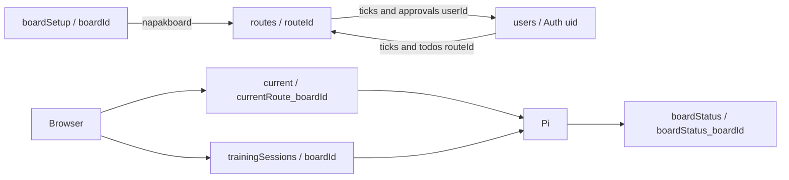

# Firestore Data Contracts

## Schema Status

There is no checked-in database schema, migration set, rules file, or index definition. This document describes fields read or written by the code; their presence and types are not guaranteed by an inspected server-side schema. Firestore document IDs and embedded IDs are relationships, not enforced SQL foreign keys.

## `boardSetup/<boardId>`

The selector displays document IDs as board names. Board renderers read the document's nested `boardSetup` object.

| Nested field | Observed use |
| --- | --- |
| `boardSetup.characteristics.height`, `.width` | Grid dimensions |
| `.characteristics.adjustable` | Enables angle UI/filtering |
| `boardSetup.owner` | Firebase Auth UID used for owner-only setup/archive UI |
| `boardSetup.holdSetup` | Stored coordinate -> visual hold object |
| `boardSetup.mirrorCols` | Column mapping used when automatically creating a mirrored route |

Visual hold objects use `hold` (SVG shape class), `rotation`, `offsetX`, `offsetY`, `scaleX`, `scaleY`, `holdColor`, and `mirror`. Percent-like scale values default to 100 in the setup UI. The renderer initializes entries for grid cells; setup can remove configured entries. These visual objects are distinct from route hold-type values.

No board-creation form or schema-enforcing ownership operation is found. Setup Save uses `updateDoc`, so the document must already exist. Local setup JSON files are fallback/sample inputs, not Firestore migrations.

## `routes/<generatedRouteId>`

| Field | Observed type / purpose |
| --- | --- |
| `added` | `Date` written through SDK, read as Firestore Timestamp with `toDate()` |
| `name`, `setter`, `setterID` | Route name, setter display string, setter Auth UID |
| `grade` | Index into the grade labels; select controls can provide strings, calculations coerce as needed |
| `napakboard` | Board document ID; query/filter relationship |
| `angle` | Number; normal fixed-board save coerces null to zero |
| `mirror` | Boolean; all selected holds must be marked mirrored for automatic mirrored-route creation |
| `holdSetup` | Stored hold ID -> hold-type string; training also accepts `{type: ...}` values |
| `archived` | Boolean soft-delete/filter flag |
| `ticks` | Array of climber Auth UIDs, not individual ascent records |
| `approvals` | Array of `{userId, value, difficulty, date}`; scoring also accepts legacy numeric approval entries |
| `tickLog` | Array of `{userId, userName, type, approval, difficulty, comment, date}` |
| `training` | Boolean training marker |
| `tags` | Array or legacy scalar; case-insensitive `training` also marks training routes |
| `lightingOrder` | Saved array of `{holds: string[]}` sets; readers also accept string/array entries |
| `trainingUpdatedAt` | Date written when saving a sequence; deleted on sequence removal |

Hold types used by the application are `intermediate`, `foot`, `start`, and `top`. Coordinates are letter columns with top-down one-based rows; UI numbering may be bottom-up. START and END sets may include companion holds. The editor pins fixed hold types, requires all route holds to be sequenced before enabling Save, and preserves companions on normalization. The Pi fills in unspecified non-fixed holds as individual middle steps, unlike the editor.

Tick types are `flash` and `redpoint`; approval/difficulty choices are -1, 0, and 1. Array dates are millisecond numbers. Tick removal removes that user's route membership, approvals, log entries, and user-side history entries for that route. No uniqueness rule is verified beyond client filtering/array transforms.

## `users/<FirebaseAuthUid>`

| Field | Observed type / purpose |
| --- | --- |
| `email` | Written at signup; display name is held in Firebase Auth instead |
| `ticks` | Array of `{routeId, type, approval, difficulty, comment, date}` |
| `todos` | Array of `{routeId, date}` references |

Profile resolves TODO route names by fetching referenced route documents. History joins user ticks to routes for the active board. TODO transforms preserve unrelated user fields; the tick workflow also removes completed routes from TODOs. References to missing routes remain possible. There is no transactional consistency between these arrays and route-side arrays.

## `current/currentRoute_<boardId>`

Normal command document: `boardId`, `routeId`, `routeName`, and `routeData: {holdSetup}`. This is a snapshot payload rather than a required reference to an existing route; setup and unsaved routes use sentinel IDs. The Pi compares `routeData` JSON to suppress repeated payloads. Training clearing does not delete this persisted command.

## `trainingSessions/<boardId>`

One shared command/settings document per board, not a collection of immutable sessions. Fields: `boardId`, `mode`, `sessionId`, `updatedBy`, `status`, `startDelaySeconds`, `holdIntervalSeconds`, `restSeconds`, `routeIds`, `routes`, `currentRouteIndex`, `currentStepIndex`, `updatedAt`, and optional `stopReason`.

`routes` contains route snapshots with `routeId`, `routeName`, `holdSetup`, and complete `lightingOrder` sets. The browser merges whole command snapshots for control transitions; the Pi may load referenced routes when snapshots lack holds. The queue is deduplicated by selected route ID in the browser, and only settings are restored when revisiting the training page. Multiple clients can overwrite this shared document; no lock or ownership field is enforced in the inspected code.

## `boardStatus/boardStatus_<boardId>`

Fields written by the Pi include `boardId`, `lastSeenAt`, `routeId`, `routeName`, `screensaverOn`, `screensaverMode`, `statusReason`, `trainingMode`, `trainingSessionId`, `trainingStatus`, `trainingRouteIndex`, `trainingStepIndex`, and `trainingCountdownDeadline`. Some status writes merge only a subset, so old fields can remain. `lastSeenAt` and the countdown deadline are millisecond numbers, not Firestore timestamps. Startup/state changes update status; there is no dedicated heartbeat loop.

## Queries, Indexes, Constraints, and Ownership

Main route queries are `where('napakboard', '==', globals.board)`. Sorting/filtering is otherwise in memory. Board selection queries all `boardSetup` documents; setup archiving queries all `routes`. No composite indexes or index exemptions are checked in. Their production configuration, SDK read charges, limits, and actual rules must be checked in Firebase separately.

Owner/setter/climber IDs are client-side data relationships. The code's owner-based UI visibility is not proof of write authorization. Large embedded arrays, inconsistent date types, and partial multi-document mutations are the main data-model risks.

## Related Code

[Normal route writer](../js/components/system_board/route-editor.js), [ticks](../js/components/system_board/route-ticker.js), [TODO cache](../js/components/system_board/route-list.js), [setup](../js/components/board_setup/board_setup.js), [training editor](../js/templates/page_training-route.js), [session writer](../js/templates/page_training-session.js), [Pi status writer](../js/raspberry/index.js).
